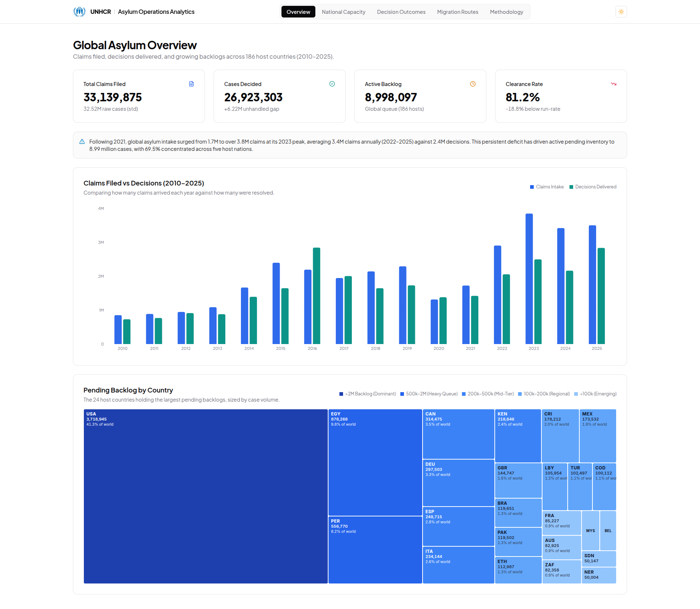
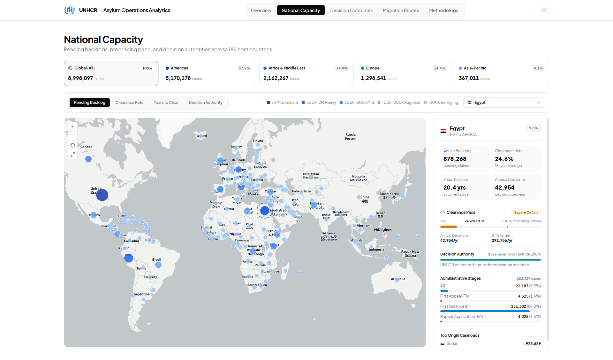
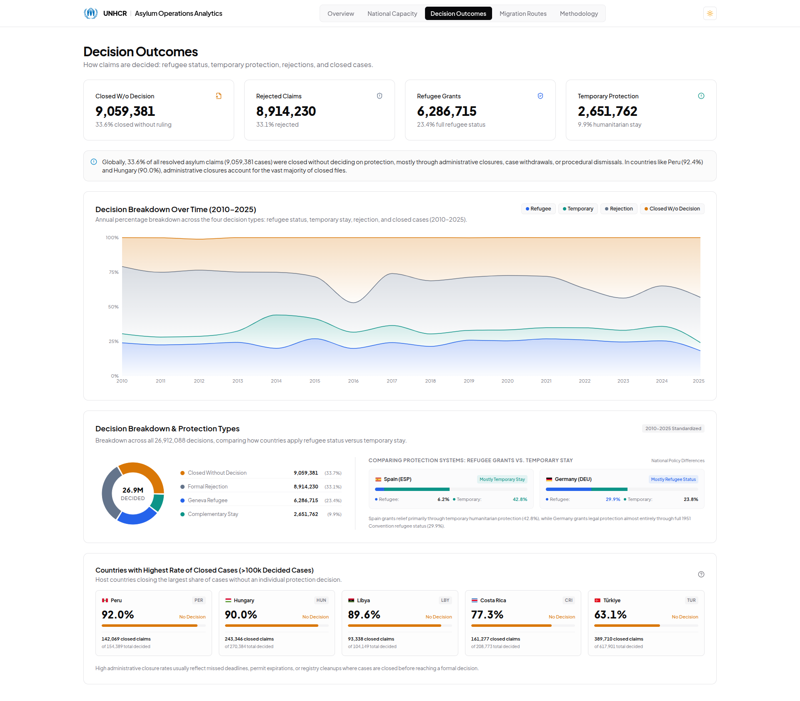
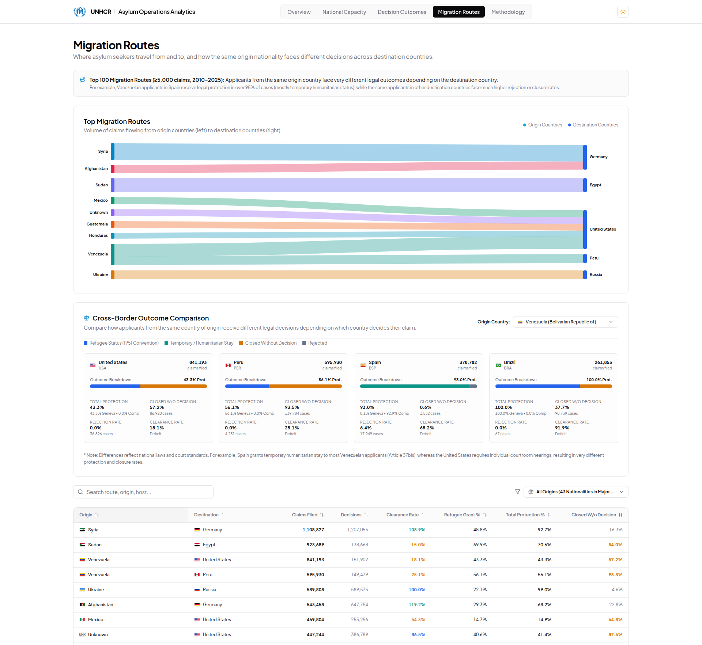

# UNHCR Asylum Analytics (2010–2025)

An end-to-end data engineering and analytics platform auditing 16 consecutive years of international asylum adjudication across 186 sovereign nations, tracking 33.14 million claims from intake to decision.

**[View Live Interactive Dashboard](https://unhcr-asylum-analytics.vercel.app)** · **[Explore GitHub Repository](https://github.com/dionis36/unhcr-asylum-analytics)**

---

## Project Overview

Sovereign court systems and international protection bodies face acute administrative strain. Over the past 16 years (2010 through 2025), armed conflicts and humanitarian displacement have driven millions of individuals to seek legal protection across borders. However, public discussions frequently conflate total border arrivals with judicial processing capacity, obscuring the administrative mechanics that govern asylum adjudication.

This project audits international asylum data from an operational court-administration perspective. Using official microdata and aggregate ledgers published by the United Nations High Commissioner for Refugees (UNHCR) across 186 host jurisdictions, it tracks how many claims entered host legal systems, how many decisions were reached, how rapidly backlogs accumulated, and how many claims were closed without a substantive merits ruling.

The analytical pipeline processes 33.14 million standardized claims (32.52M raw) and 26.92 million substantive legal determinations (26.00M raw) across 16 calendar years. Findings are delivered through an interactive web application built with DuckDB, Next.js 14, MapLibre GL, and Tailwind CSS.

## Project Objectives

- **Audit the Global Intake-Output Gap:** Measure the 16-year throughput deficit between incoming claims filed and substantive decisions rendered across 186 sovereign hosts.
- **Model Judicial Clearance Horizons (Years to Clear):** Calculate the operational runway required to exhaust active pending inventories under current decision throughput with static intake.
- **Quantify Non-Decisional Case Attrition ("Ghost Cases"):** Measure claims terminated through administrative closures, procedural dismissals, or docket write-offs before an individual merits ruling.
- **Investigate Protection Model Divergence:** Examine how host states alter legal dispositions (substituting temporary subsidiary stay for permanent 1951 Geneva Convention status) during volume surges.
- **Map Decision Authority Allocation:** Determine the institutional division of adjudication responsibility between sovereign national tribunals and delegated UNHCR mandate operations.
- **Interactive Visualizations:** Present operational findings through a responsive web application supporting global vector cartography, streamgraphs, and bilateral corridor matrices.

## Dataset Provenance

Data is drawn from official statistics published by the United Nations High Commissioner for Refugees (UNHCR), obtained from the UNHCR Refugee Data Finder and the UN Population Statistics Database.

- **Time Period:** 2010–2025 (16 consecutive calendar years)
- **Host Jurisdictions:** 186 sovereign states and mandate territories
- **Standardized Claims Filed:** 33,139,875 applications (32,524,694 raw)
- **Substantive Determinations:** 26,923,303 decided claims (26,001,894 raw)
- **Active Pending Backlog (2025):** 8,998,097 unresolved claims
- **Year-End Pending Stock Records:** 83,289 annual (Year, Host, Origin) tuples

### Primary Source Tables

| Dataset | Source File | Scope | Description |
|---|---|---|---|
| New Applications | `asylum-applications.csv` | Flow (Annual) | Claims lodged within calendar years, categorized by application type (New, Repeat, Appeal) and procedural stage. |
| Decisions Rendered | `asylum-decisions.csv` | Flow (Annual) | Substantive outcomes recorded by authority: Geneva Convention refugee status, complementary protection, rejections, and administrative closures. |
| Pending Backlog Stock | `persons-of-concern.csv` | Stock (Dec 31 Snapshot) | Active inventory of unresolved individuals awaiting an initial or appellate ruling at year-end (`ASY` population type). |
| Official Multipliers | `footnotes.csv` | Metadata / Weights | Official statistical adjustment footnotes specifying jurisdictions that record family units rather than individual persons (e.g., US cases ×1.50, UK claims ×1.30 per official UNHCR guidance). |

## Tools and Technologies

| Tool | Purpose |
|---|---|
| DuckDB | Embedded columnar SQL OLAP database used for data ingestion, multi-stage CTE transformations, key deduplication, and Parquet data mart compilation. |
| Python & PyArrow / Pandas | Pipeline orchestration, statutory multiplier standardization, exploratory arithmetic auditing, and static JSON data mart exports. |
| Next.js 14 (App Router) | React web application framework delivering static site generation, strict TypeScript typing, and client-side navigation. |
| MapLibre GL | Vector cartography rendering 186 sovereign jurisdictions with interactive hover tooltips and dynamic metric scales. |
| Recharts | Composable SVG visualization library powering intake-output trajectories, 16-year outcome streamgraphs, and treemaps. |
| Tailwind CSS | Utility styling engine enforcing institutional design tokens, dynamic font switching (`var(--font-active)`), and dark mode support. |

### Analytical & Technical Concepts Used

- Multi-stage Common Table Expressions (CTEs)
- Composite Key Alignment & Grain Deduplication
- Dual-Ledger Accounting (Raw Historical vs. Standardized Headcounts)
- Stock-Flow Reconciliation & Inventory Runway Modeling (Years to Clear)
- Columnar Data Mart Optimization (DuckDB $\rightarrow$ Parquet $\rightarrow$ Static JSON)
- WebGL Vector Cartography & Viewport Ergonomics
- Dynamic CSS Token Architecture

## Engineering Highlights & Analytical Problem-Solving

### 1. Cartesian Join Resolution & Key Deduplication
In the raw UNHCR datasets, application and decision records are partitioned across multiple procedural dimensions (Application Type: *New*, *Repeat*, *Appeal*; Procedural Stage: *First Instance*, *Administrative Review*, *Judicial Review*). Joining the raw tables on naive tuples `(Year, Host, Origin)` caused Cartesian duplication, inflating claims and determinations by over 35%. 

To resolve this, the pipeline uses pre-aggregation CTEs in DuckDB to consolidate records at the strict `(Year, Host, Origin)` grain before performing flow joins, ensuring exact arithmetic parity with official UNHCR headline reports.

### 2. Dual-Ledger Accounting for Family Multipliers
Certain sovereign jurisdictions record asylum applications as family units or dockets rather than individual persons (notably the United States and the United Kingdom). Comparing raw filings between the United States and Germany created an artificial distortion where US intake appeared substantially understated. 

By incorporating UNHCR statistical footnotes, official multipliers (1.50× for US cases, 1.30× for UK claims) were integrated into a dual-ledger pipeline. This preserves both raw administrative filings and standardized person-level headcounts across every metric.

### 3. Stock vs. Flow Accounting for Periodic Census Purges
Active inventory changes theoretically equal inflow minus dispositions ($\Delta S = I - D$). In practice, sovereign host governments periodically conduct unannounced registry audits (such as South Africa or Peru writing off large tranches of dormant files in a single census year) without recording individual formal decision records. 

As a result, the 16-year cumulative flow deficit (6.22 million unadjudicated claims) operates alongside an 8.16 million net increase in reported pending stock (expanding from 835,969 in 2010 to 8,998,097 in 2025). The platform tracks both operational dynamics independently to maintain accurate balance-sheet accounting.

### 4. Precompiled Static Analytics Marts
The Python build script (`scripts/build_analytics_marts.py`) compiles the consolidated DuckDB tables into static JSON payloads under 150 KB. Hosted on Vercel, the dashboard performs instantaneous client-side filtering without requiring a dedicated database server.

## Key Structural Findings

### 1. Global Backlog Expanded Tenfold (2010–2025)
The worldwide inventory of unresolved asylum claims grew from 835,969 in 2010 to 8,998,097 in 2025 (a 10.8× expansion). Growth accelerated after 2015 and surged further between 2021 and 2024 as multiple regional crises compounded simultaneously.

### 2. Geographic Concentration in the United States
As of 2025, the United States holds 3,718,945 pending asylum cases, representing 41.3% of the world's unresolved inventory. Egypt holds the second-largest pending backlog (878,268 cases, driven by conflict in Sudan), followed by Peru (556,770 cases, driven by Venezuelan displacement).

### 3. Cumulative 16-Year Operating Deficit
Across all 186 host jurisdictions, incoming claims (33.14M standardized) consistently outpaced substantive determinations (26.92M standardized). The global 16-year Case Clearance Rate averaged 81.2%, producing a cumulative operational shortfall of 6,216,572 claims where intake overwhelmed adjudication capacity.

### 4. Administrative Closures Without Merits Rulings
Over 9,059,381 cases (33.7% of all closed proceedings) were terminated without a substantive merits ruling. High administrative closure rates are concentrated in specific jurisdictions: Peru closed 92.0% of its resolved caseload without a ruling, South Africa closed 62.7%, and the United States terminated 57.6% administratively.

### 5. Protection Model Divergence During Crises
Host nations respond to major displacement waves using divergent legal instruments. When handling Venezuelan arrivals, Spain grants temporary subsidiary protection to 92.2% of applicants while maintaining a formal 1951 Convention refugee grant rate near zero (0.11%). In contrast, Germany grants protection to 92.7% of Syrian applicants, divided between full 1951 Convention refugee status (48.8%) and subsidiary protection (43.9%).

### 6. The Decision Authority Divide
Wealthier destination countries in North America and Western Europe process 100% of claims through sovereign government tribunals. Major transit states in North Africa and Southeast Asia rely almost entirely on delegated UNHCR mandate determination, where legal adjudication capacity is constrained by international agency funding rather than domestic court staffing.

## Interactive Dashboard Walkthrough

### 1. Global Asylum Overview
Examines global intake versus output trajectories (2010–2025), core KPI counters, and the national backlog concentration treemap sizing the 24 largest pending queues.

[](https://unhcr-asylum-analytics.vercel.app)

*Explore view: [unhcr-asylum-analytics.vercel.app](https://unhcr-asylum-analytics.vercel.app)*

---

### 2. National Capacity
Interactive vector map covering 186 sovereign hosts across four operational lenses: Case Clearance Rate (CCR), Pending Backlog, Years to Clear Runway (YTC), and Decision Authority (National Government, Joint System, or UNHCR Mandate). Includes an interactive country dossier with administrative stages and regional capacity metrics.

[](https://unhcr-asylum-analytics.vercel.app/map)

*Explore view: [unhcr-asylum-analytics.vercel.app/map](https://unhcr-asylum-analytics.vercel.app/map)*

---

### 3. Decision Outcomes
Audits the four legal dispositions over 16 years through a stacked area streamgraph, examines the 33.7% administrative closure phenomenon, ranks countries closing the highest share of claims without a ruling, and contrasts the substantive protection models of Spain and Germany.

[](https://unhcr-asylum-analytics.vercel.app/due-process)

*Explore view: [unhcr-asylum-analytics.vercel.app/due-process](https://unhcr-asylum-analytics.vercel.app/due-process)*

---

### 4. Migration Routes
Visualizes bilateral origin-to-destination corridors ($\ge$5,000 claims) using flow visuals, a searchable 100-corridor analytical matrix, and a cross-border outcome comparator showing how legal protection varies by destination for the same origin nationalities.

[](https://unhcr-asylum-analytics.vercel.app/corridors)

*Explore view: [unhcr-asylum-analytics.vercel.app/corridors](https://unhcr-asylum-analytics.vercel.app/corridors)*

---

### 5. Project Methodology
Technical documentation detailing dataset provenance, statutory multiplier definitions, mathematical formulas for all operational metrics, analytical caveats, and author attribution.

*Explore view: [unhcr-asylum-analytics.vercel.app/methodology](https://unhcr-asylum-analytics.vercel.app/methodology)*

## Repository Structure

```text
unhcr-asylum-analytics/
├── assets/                       # Dashboard previews and architectural images
│   ├── p01.png                   # Global Asylum Overview preview
│   ├── p02.png                   # National Capacity vector map preview
│   ├── p03.png                   # Decision Outcomes streamgraph preview
│   └── p04.png                   # Migration Routes bilateral matrix preview
│
├── data/
│   ├── raw/                      # Original UNHCR CSV files (applications, decisions, population, footnotes)
│   └── processed/                # Local DuckDB database and optimized Parquet marts
│
├── notebooks/                    # Exploratory data auditing & arithmetic verification
│   └── 01_exploratory_data_audit.ipynb
│
├── scripts/                      # Data pipeline & JSON data mart generation
│   └── build_analytics_marts.py  # DuckDB OLAP pipeline and mart compiler
│
├── web/                          # Next.js 14 web analytics application
│   ├── public/data/              # Static JSON analytics marts for client-side load
│   └── src/
│       ├── app/                  # App Router pages (/, /map, /due-process, /corridors, /methodology)
│       ├── components/           # UI components, MapLibre canvas, Recharts visuals
│       ├── lib/                  # Semantics, color tokens, and data loader
│       └── types/                # Strict TypeScript data schemas
│
├── requirements.txt              # Python runtime dependencies
└── README.md
```

## How to Run the Project Locally

### Prerequisites
- **Node.js:** v18.17.0 or higher
- **Python:** v3.10 or higher
- **npm:** v9.0.0 or higher

### 1. Clone the Repository
```bash
git clone https://github.com/dionis36/unhcr-asylum-analytics.git
cd unhcr-asylum-analytics
```

### 2. Python Environment & Data Pipeline Setup
```bash
# Create and activate virtual environment
python -m venv .venv
source .venv/bin/activate  # On Windows: .venv\Scripts\activate

# Install dependencies
pip install -r requirements.txt

# Run analytical build script
python scripts/build_analytics_marts.py
```

### 3. Run the Next.js Analytics Web Client
```bash
# Navigate to web application directory
cd web

# Install dependencies
npm install

# Start local development server
npm run dev
```

Open [http://localhost:3000](http://localhost:3000) in your browser to explore the dashboard.

## Methodological Limitations and Caveats

- **Stock vs. Flow Census Purges:** Host governments periodically conduct unannounced registry write-offs (such as South Africa or Peru writing off dormant files) without recording formal individual merits decisions. Dual-ledger accounting was implemented specifically to monitor both operational dynamics independently.
- **Statutory Multiplier Approximations:** The 1.50× (US) and 1.30× (UK) multipliers derived from UNHCR footnotes reflect official statistical averages for family-unit applications rather than individual household censuses.
- **Ambiguity in Administrative Closures:** UNHCR aggregates procedural dismissals, applicant departures, withdrawals, and court docket purges into a single disposition category ("Closed without decision").
- **Procedural Stage Variances:** Jurisdictional reporting varies; some countries report only first-instance decisions, while others incorporate judicial reviews and appellate stages.

---

## Author

**Dionis Ludovick Nasuwa**  
*A data analyst and software developer.*

- **Portfolio:** [dio.is-a.dev](https://dio.is-a.dev/)
- **GitHub:** [github.com/dionis36](https://github.com/dionis36/)
- **LinkedIn:** [linkedin.com/in/dionis-nasuwa](https://linkedin.com/in/dionis-nasuwa/)
- **Data Source:** [UNHCR Refugee Data Finder](https://www.unhcr.org/refugee-statistics/)
